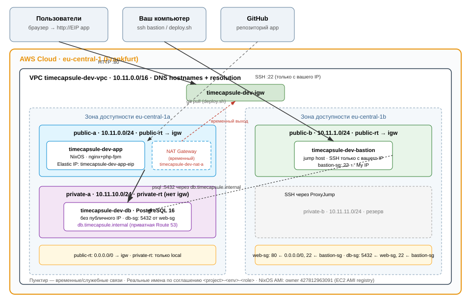

# Лабораторная работа №3. Облачные сети. Amazon VPC (NixOS edition)

|                   |                                                           |
| ----------------- | --------------------------------------------------------- |
| **Студент**       | Croitor Alexandr (Кройтор Александр)                      |
| **Группа**        | IA2403                                                    |
| **Специальность** | Informatică aplicată                                      |
| **k / X**         | k = 11, X = k % 30 = **11** → диапазон VPC `10.11.0.0/16` |
| **Уровень**       | **Продвинутый** (Часть 1: зад. 1–7 + Часть 2: зад. 8–14)  |
| **Репозиторий**   | <https://github.com/yorunikakeru4/timecapsule>            |
| **Регион**        | `eu-central-1` (Frankfurt)                                |

> **Ключевое отличие от «базового» выполнения.** Все серверы — **NixOS** стабильного канала `26.05`, образ берётся из **официального реестра EC2** (Account ID `427812963091`, публичные AMI проекта NixOS; <https://nixos.github.io/amis/>), а не Amazon Linux 2023. Конфигурация bastion/app/db описана декларативно во flake (`nixos/flake.nix`), инфраструктура AWS — командами AWS CLI, приведёнными ниже **покадрово в самом отчёте**: каждое задание читается сверху вниз как журнал выполнения — команда, ожидаемый вывод, дальше. Вместо «сделать AMI с веб-сервера ЛР2» (задание 8) состояние сервера воспроизводится из git через `nixos-rebuild`, поэтому снимки дисков создавать и удалять не нужно.
>
> Ключевой пар (как в ЛР2): `~/.ssh/croitor.a-kepair.pem`, в AWS — key pair `croitor.a-kepair`.

## Содержание

- [Что построено](#что-построено)
- [Часть 1. Базовый уровень](#часть-1-базовый-уровень)
  - [Задание 1. План адресов](#задание-1-план-адресов)
  - [Задание 2. VPC и подсети](#задание-2-vpc-и-подсети)
  - [Задание 3. Internet Gateway и таблицы маршрутов](#задание-3-internet-gateway-и-таблицы-маршрутов)
  - [Задание 4. Security Group](#задание-4-security-group)
  - [Задание 5. Экземпляры](#задание-5-экземпляры)
  - [Задание 6. Временный NAT Gateway](#задание-6-временный-nat-gateway)
  - [Задание 7. Проверки](#задание-7-проверки)
- [Часть 2. Продвинутый уровень](#часть-2-продвинутый-уровень)
  - [Задание 8. Перенос сервера ЛР2 в новую сеть](#задание-8-перенос-сервера-лр2-в-новую-сеть)
  - [Задание 9. Elastic IP](#задание-9-elastic-ip)
  - [Задание 10. База данных приложения на db-server](#задание-10-база-данных-приложения-на-db-server)
  - [Задание 11. Приватная зона Route 53](#задание-11-приватная-зона-route-53)
  - [Задание 12. Перенос данных и переключение приложения](#задание-12-перенос-данных-и-переключение-приложения)
  - [Задание 13. Деплой и обслуживание](#задание-13-деплой-и-обслуживание)
  - [Задание 14. Архитектура и решение](#задание-14-архитектура-и-решение)
- [Завершение работы](#завершение-работа)
- [Ответы на контрольные вопросы](#ответы-на-контрольные-вопросы)

---

## Что построено



_Рис. 1. Сеть `timecapsule-dev-vpc`. NixOS-серверы, временный NAT (пунктир), приватная Route 53._

| Слой                    | Ресурс                                            | Как создан (секция отчёта) |
| ----------------------- | ------------------------------------------------- | -------------------------- |
| Сеть                    | VPC, 4 подсети, IGW, 2 rt                         | зад. 2–3                   |
| Фильтрация              | bastion-sg / web-sg / db-sg                       | зад. 4                     |
| Интернет для private-\* | NAT GW + EIP (временный)                          | зад. 6, 13                 |
| Серверы                 | bastion, app, db на NixOS 26.05                   | зад. 5                     |
| Конфигурация ОС         | nginx+PHP8.4+PDO(pgsql) / PostgreSQL 16 / openssh | зад. 5–6, 10               |
| Приложение              | TimeCapsule (PHP)                                 | зад. 8, 13                 |
| DNS                     | приватная `timecapsule.internal`                  | зад. 11                    |
| Постоянный адрес        | Elastic IP app                                    | зад. 9                     |

В репозитории: `app/` → содержимое клонируется в `/var/www/timecapsule`; `nixos/` — конфигурации серверов; `docs/` — этот отчёт и ADR.

---

## Часть 1. Базовый уровень

### Задание 1. План адресов

X = 11 → все диапазоны считаются из `10.11.0.0/16`.

| Подсеть     | Зона доступности | Диапазон        | Первый и последний адрес, доступный экземплярам |
| ----------- | ---------------- | --------------- | ----------------------------------------------- |
| `public-a`  | `eu-central-1a`  | `10.11.0.0/24`  | `10.11.0.4` — `10.11.0.254`                     |
| `public-b`  | `eu-central-1b`  | `10.11.1.0/24`  | `10.11.1.4` — `10.11.1.254`                     |
| `private-a` | `eu-central-1a`  | `10.11.10.0/24` | `10.11.10.4` — `10.11.10.254`                   |
| `private-b` | `eu-central-1b`  | `10.11.11.0/24` | `10.11.11.4` — `10.11.11.254`                   |

**Почему не 256?** AWS резервирует в каждой подсети **4 адреса**: `.0` (адрес сети), `.1` (шлюз сети), `.2` (резерв под службы AWS, DHCP) и `.255` (broadcast). Экземплярам достаются оставшиеся **251**.

**Сколько ещё `/24` поместится в VPC?** VPC — `/16`, то есть 256 подсетей `/24`; заняты 4 → свободно **252**. Схема нумерации (публичные с `10.11.0`, приватные с `10.11.10`) оставляет «дырки» под новые группы подсетей.

### Задание 2. VPC и подсети

**VPC.** `Resources to create: VPC only`, диапазон из таблицы, все обязательные теги. Каждый ресурс обязан получить `Name`, `Project`, `Environment`, `Owner`, `Lab` — соберём их в функцию, она подставляется в `--tag-specifications` каждой команды отчёта:

```bash
OWNER=croitor.a
tags() {
  echo "ResourceType=$1,Tags=[{Key=Name,Value=$2},{Key=Project,Value=timecapsule},\
{Key=Environment,Value=dev},{Key=Owner,Value=$OWNER},{Key=Lab,Value=lab3}]"
}
```

Сама VPC:

```bash
VPC_ID=$(aws ec2 create-vpc --cidr-block 10.11.0.0/16 \
  --tag-specifications "$(tags vpc timecapsule-dev-vpc)" \
  --query 'Vpc.VpcId' --output text)
echo "VPC_ID=$VPC_ID"
```

**DNS-имена.** Разрешение DNS включено по умолчанию, а `Enable DNS hostnames` **обязателен** — без него не заработает приватная зона Route 53 из задания 11:

```bash
aws ec2 modify-vpc-attribute --vpc-id "$VPC_ID" --enable-dns-support '{"Value":true}'
aws ec2 modify-vpc-attribute --vpc-id "$VPC_ID" --enable-dns-hostnames '{"Value":true}'
```

**Четыре подсети** (в консоли их можно добавить через `Add new subnet` в одной форме; здесь — по одной команде, все в своей зоне доступности):

```bash
PUB_A=$(aws ec2 create-subnet --vpc-id "$VPC_ID" --cidr-block 10.11.0.0/24 \
  --availability-zone eu-central-1a --tag-specifications "$(tags subnet timecapsule-dev-public-a)" \
  --query 'Subnet.SubnetId' --output text)
PUB_B=$(aws ec2 create-subnet --vpc-id "$VPC_ID" --cidr-block 10.11.1.0/24 \
  --availability-zone eu-central-1b --tag-specifications "$(tags subnet timecapsule-dev-public-b)" \
  --query 'Subnet.SubnetId' --output text)
PRV_A=$(aws ec2 create-subnet --vpc-id "$VPC_ID" --cidr-block 10.11.10.0/24 \
  --availability-zone eu-central-1a --tag-specifications "$(tags subnet timecapsule-dev-private-a)" \
  --query 'Subnet.SubnetId' --output text)
PRV_B=$(aws ec2 create-subnet --vpc-id "$VPC_ID" --cidr-block 10.11.11.0/24 \
  --availability-zone eu-central-1b --tag-specifications "$(tags subnet timecapsule-dev-private-b)" \
  --query 'Subnet.SubnetId' --output text)
```

**Auto-assign public IPv4** для публичных подсетей — иначе маршрут в IGW бесполезен: шлюзу не на что заменять приватный адрес:

```bash
aws ec2 modify-subnet-attribute --subnet-id "$PUB_A" --map-public-ip-on-launch
aws ec2 modify-subnet-attribute --subnet-id "$PUB_B" --map-public-ip-on-launch
```

Вместе с VPC AWS создал три ресурса без имени: main route table, Network ACL и default Security Group — они здесь не используются: каждая подсеть будет явно привязана к своей таблице.

> **Является ли подсеть `public-a` сейчас публичной? Почему?**
> Нет. «Публичность» — это не имя, а **маршрут `0.0.0.0/0 → Internet Gateway` в таблице маршрутов подсети** плюс включённый auto-assign public IP. До задания 3 ни того, ни другого нет: подсеть названа «public», но из неё не выйти наружу и снаружи к ней не прийти. Имя — план, маршрут — факт.

### Задание 3. Internet Gateway и таблицы маршрутов

**IGW** создаётся в состоянии `Detached` и сразу подключается к VPC:

```bash
IGW_ID=$(aws ec2 create-internet-gateway \
  --tag-specifications "$(tags internet-gateway timecapsule-dev-igw)" \
  --query 'InternetGateway.InternetGatewayId' --output text)
aws ec2 attach-internet-gateway --internet-gateway-id "$IGW_ID" --vpc-id "$VPC_ID"
```

**Публичная таблица маршрутов** — единственный маршрут `0.0.0.0/0` → IGW и ассоциации с обеими публичными подсетями:

```bash
PUB_RT=$(aws ec2 create-route-table --vpc-id "$VPC_ID" \
  --tag-specifications "$(tags route-table timecapsule-dev-public-rt)" \
  --query 'RouteTable.RouteTableId' --output text)
aws ec2 create-route --route-table-id "$PUB_RT" \
  --destination-cidr-block 0.0.0.0/0 --gateway-id "$IGW_ID"
aws ec2 associate-route-table --route-table-id "$PUB_RT" --subnet-id "$PUB_A"
aws ec2 associate-route-table --route-table-id "$PUB_RT" --subnet-id "$PUB_B"
```

**Приватная таблица маршрутов** — маршрутов не добавляем, привязываем приватные подсети:

```bash
PRV_RT=$(aws ec2 create-route-table --vpc-id "$VPC_ID" \
  --tag-specifications "$(tags route-table timecapsule-dev-private-rt)" \
  --query 'RouteTable.RouteTableId' --output text)
aws ec2 associate-route-table --route-table-id "$PRV_RT" --subnet-id "$PRV_A"
aws ec2 associate-route-table --route-table-id "$PRV_RT" --subnet-id "$PRV_B"
```

```bash
aws ec2 describe-route-tables --route-table-ids "$PUB_RT" "$PRV_RT" \
  --query 'RouteTables[].{Name:Tags[?Key==`Name`].Value|[0],Routes:Routes[].{Cidr:DestinationCidrBlock,Target:GatewayId||NatGatewayId}}' \
  --output table
```

```text

---------------------------------------------
|            DescribeRouteTables            |
+-------------------------------------------+
|                   Name                    |
+-------------------------------------------+
|  timecapsule-dev-private-rt               |
+-------------------------------------------+
||                 Routes                  ||
|+------------------------+----------------+|
||          Cidr          |    Target      ||
|+------------------------+----------------+|
||  10.11.0.0/16          |  local         ||
|+------------------------+----------------+|
|            DescribeRouteTables            |
+-------------------------------------------+
|                   Name                    |
+-------------------------------------------+
|  timecapsule-dev-public-rt                |
+-------------------------------------------+
||                 Routes                  ||
|+---------------+-------------------------+|
||     Cidr      |         Target          ||
|+---------------+-------------------------+|
||  10.11.0.0/16 |  local                  ||
||  0.0.0.0/0    |  igw-096c85ed74a124467  ||
|+---------------+-------------------------+|
```

> **Какой маршрут есть в обеих таблицах, хотя вы его не добавляли? Что он даёт?**
> `10.11.0.0/16 → local`. Его AWS создаёт автоматически: он направляет весь трафик внутри VPC на локальную маршрутизацию хостинга. Именно он даёт связь `public-a ↔ private-a ↔ public-b ↔ private-b` без шлюзов — app из `public-a` достучится до db в `private-a` вообще без NAT/IGW.
>
> **Куда уйдёт пакет из `private-a`, адресованный `8.8.8.8`?**
> В `private-rt` есть только `local`-маршрут — пакета `8.8.8.8` в таблице нет, он будет отброшен (destination unreachable). SG и pg_hba ещё ни при чём: первым решает маршрут. Именно поэтому `curl` с db-server падает, пока мы не добавим `0.0.0.0/0 → nat` (задание 6).

### Задание 4. Security Group

Группы создаются **строго по порядку** — группу можно указать источником только после её создания.

**Первая — bastion-sg:** SSH только с вашего адреса. Узнаём свой внешний IP и вешаем тег `Name` (поле `Security group name` в консоли — это не тег!):

```bash
MY_IP=$(curl -s https://checkip.amazonaws.com)/32
echo "мой IP: $MY_IP"

BASTION_SG=$(aws ec2 create-security-group \
  --group-name timecapsule-dev-bastion-sg \
  --description "SSH access to bastion" \
  --vpc-id "$VPC_ID" \
  --tag-specifications "$(tags security-group timecapsule-dev-bastion-sg)" \
  --query 'GroupId' --output text)
aws ec2 authorize-security-group-ingress --group-id "$BASTION_SG" \
  --ip-permissions "IpProtocol=tcp,FromPort=22,ToPort=22,IpRanges=[{CidrIp=$MY_IP,Description=Admin laptop}]"
```

**Вторая — web-sg:** HTTP из интернета + SSH только от bastion-sg:

```bash
WEB_SG=$(aws ec2 create-security-group \
  --group-name timecapsule-dev-web-sg \
  --description "Web server: HTTP from internet, SSH via bastion" \
  --vpc-id "$VPC_ID" \
  --tag-specifications "$(tags security-group timecapsule-dev-web-sg)" \
  --query 'GroupId' --output text)
aws ec2 authorize-security-group-ingress --group-id "$WEB_SG" \
  --ip-permissions "IpProtocol=tcp,FromPort=80,ToPort=80,IpRanges=[{CidrIp=0.0.0.0/0,Description=HTTP}]"
aws ec2 authorize-security-group-ingress --group-id "$WEB_SG" \
  --ip-permissions "IpProtocol=tcp,FromPort=22,ToPort=22,UserIdGroupPairs=[{GroupId=$BASTION_SG,Description=SSH via bastion}]"
```

**Третья — db-sg:** PostgreSQL только от web-sg, SSH только от bastion-sg:

```bash
DB_SG=$(aws ec2 create-security-group \
  --group-name timecapsule-dev-db-sg \
  --description "PostgreSQL from web/app only, SSH via bastion" \
  --vpc-id "$VPC_ID" \
  --tag-specifications "$(tags security-group timecapsule-dev-db-sg)" \
  --query 'GroupId' --output text)
aws ec2 authorize-security-group-ingress --group-id "$DB_SG" \
  --ip-permissions "IpProtocol=tcp,FromPort=5432,ToPort=5432,UserIdGroupPairs=[{GroupId=$WEB_SG,Description=PostgreSQL from web/app}]"
aws ec2 authorize-security-group-ingress --group-id "$DB_SG" \
  --ip-permissions "IpProtocol=tcp,FromPort=22,ToPort=22,UserIdGroupPairs=[{GroupId=$BASTION_SG,Description=SSH via bastion}]"
```

> **Почему в `db-sg` источником указана группа `web-sg`, а не адрес веб-сервера или `10.11.0.0/16`?**
> SG ссылается на **другую группу**, а не на IP: правило само «следует» за инстансами в `web-sg` — при замене app-server ничего править не нужно. Диапазон `10.11.0.0/16` слишком широк (там же bastion и будущие серверы), конкретный IP хрупок при stop/start без EIP. Группа привязывается к **роли**, а не к сетевому местоположению.

### Задание 5. Экземпляры

Запускаем три инстанса: `t3.micro`, key pair `croitor.a-kepair`, все — **NixOS AMI** из официального реестра EC2 (Account ID `427812963091`; образы публикуются еженедельно, старые чистятся через 90 дней — поэтому ID вычисляется запросом, а не копируется):

```bash
aws ec2 describe-images --owners 427812963091 \
  --filters "Name=name,Values=nixos/26.05*" "Name=architecture,Values=x86_64" "Name=state,Values=available" \
  --query 'sort_by(Images,&CreationDate)[-1].{Id:ImageId,Name:Name}' --output table
AMI=$(aws ec2 describe-images --owners 427812963091 \
  --filters "Name=name,Values=nixos/26.05*" "Name=architecture,Values=x86_64" "Name=state,Values=available" \
  --query 'sort_by(Images,&CreationDate)[-1].ImageId' --output text)
```

Ключевой пар — тот же, что в ЛР2 (в AWS он зарегистрирован как `croitor.a-kepair`):

```bash
KEY=~/.ssh/croitor.a-kepair.pem
chmod 400 "$KEY"
```

Bastion намеренно в `public-b`, остальные в зоне `a` — обе зоны в работе.

**User data.** NixOS AMI понимает user-data как **выражение NixOS-модуля** (модуль `amazon-init`): инжектируем наш публичный ключ пользователю `nixos`, поднимаем ssh:

```bash
PUB=$(ssh-keygen -y -f "$KEY")
cat > userdata.nix <<EOF
{ lib, pkgs, ... }:
{
  users.users.nixos.openssh.authorizedKeys.keys = [ "$PUB" ];
  services.openssh.enable = true;
  networking.firewall.allowedTCPPorts = [ 22 ];
}
EOF
```

**Запуск:**

```bash
BASTION_ID=$(aws ec2 run-instances --image-id "$AMI" --instance-type t3.micro \
  --key-name croitor.a-kepair --subnet-id "$PUB_B" --associate-public-ip-address \
  --security-group-ids "$BASTION_SG" --user-data file://userdata.nix \
  --tag-specifications "$(tags instance timecapsule-dev-bastion)" "$(tags volume timecapsule-dev-bastion-root)" \
  --query 'Instances[0].InstanceId' --output text)

APP_ID=$(aws ec2 run-instances --image-id "$AMI" --instance-type t3.micro \
  --key-name croitor.a-kepair --subnet-id "$PUB_A" --associate-public-ip-address \
  --security-group-ids "$WEB_SG" --user-data file://userdata.nix \
  --tag-specifications "$(tags instance timecapsule-dev-app)" "$(tags volume timecapsule-dev-app-root)" \
  --query 'Instances[0].InstanceId' --output text)

DB_ID=$(aws ec2 run-instances --image-id "$AMI" --instance-type t3.micro \
  --key-name croitor.a-kepair --subnet-id "$PRV_A" \
  --security-group-ids "$DB_SG" --user-data file://userdata.nix \
  --tag-specifications "$(tags instance timecapsule-dev-db)" "$(tags volume timecapsule-dev-db-root)" \
  --query 'Instances[0].InstanceId' --output text)

aws ec2 wait instance-running --instance-ids "$BASTION_ID" "$APP_ID" "$DB_ID"
```

Адреса для отчёта:

```bash
aws ec2 describe-instances --instance-ids "$BASTION_ID" "$APP_ID" "$DB_ID" \
  --query 'Reservations[].Instances[].{Name:Tags[?Key==`Name`].Value|[0],Id:InstanceId,Priv:PrivateIpAddress,Pub:PublicIpAddress}' \
  --output table
```

**SSH-конфиг** (файл `~/.ssh/config`, блок дописывается один раз; после каждой остановки bastion перезапустите обновление `HostName`):

```bash
BASTION_IP=$(aws ec2 describe-instances --instance-ids "$BASTION_ID" \
  --query 'Reservations[0].Instances[0].PublicIpAddress' --output text)
APP_PRIV=$(aws ec2 describe-instances --instance-ids "$APP_ID" \
  --query 'Reservations[0].Instances[0].PrivateIpAddress' --output text)
DB_PRIV=$(aws ec2 describe-instances --instance-ids "$DB_ID" \
  --query 'Reservations[0].Instances[0].PrivateIpAddress' --output text)

sed -i '/^# BEGIN lab3$/,/^# END lab3$/d' ~/.ssh/config 2>/dev/null || true
cat >> ~/.ssh/config <<EOF
# BEGIN lab3
Host bastion
    HostName $BASTION_IP
    User nixos
    IdentityFile $KEY
Host app
    HostName $APP_PRIV
    User nixos
    IdentityFile $KEY
    ProxyJump bastion
Host db
    HostName $DB_PRIV
    User nixos
    IdentityFile $KEY
    ProxyJump bastion
# END lab3
EOF
chmod 600 ~/.ssh/config
```

`ProxyJump bastion` — сначала соединение к bastion, через него туннель к серверу; **приватный ключ остаётся на ноутбуке**, на bastion не копируется. Проверка: `ssh bastion`, `exit`, `ssh app`, `exit`, `ssh db`, `exit`.

**Конфигурация серверов.** bastion и app в публичных подсетях — интернет у них есть сразу, поэтому их накатываем сейчас:

```bash
tar -C nixos -czf - . | ssh bastion 'rm -rf ~/nixos && mkdir ~/nixos && tar -xzf - -C ~/nixos'
ssh bastion 'cd ~/nixos && sudo nixos-rebuild switch --flake .#bastion --accept-flake-config'

tar -C nixos -czf - . | ssh app 'rm -rf ~/nixos && mkdir ~/nixos && tar -xzf - -C ~/nixos'
ssh app 'cd ~/nixos && sudo nixos-rebuild switch --flake .#app --accept-flake-config'
```

Первый запуск идёт 5–15 минут (сборка из кэша `cache.nixos.org`). После него на app подняты nginx + PHP-FPM 8.4 с pdo_pgsql, `systemd`-юнит `timecapsule-bootstrap` клонировал приложение из GitHub в `/var/www/timecapsule` и создал `.env` — сайт открывается по публичному IP:

```bash
curl -s http://$BASTION_IP/  # подставьте публичный IP app — страница TimeCapsule
```

Скриншот отчёта: страница приложения в браузере. У **db** интернета нет — его конфигурация (и установка PostgreSQL) выполняется **после NAT, в задании 6**.

**Проблема на db.** Подключитесь `ssh db` и попробуйте накатить конфигурацию:

```bash
ssh db 'cd ~/nixos && sudo nixos-rebuild switch --flake .#db'
```

Команда зависнет/упадёт по таймауту (на NixOS это эквивалент зависшего `sudo dnf -y install postgresql16-server`) — прервите `Ctrl+C`.

> **Почему `db-server` не может скачать пакеты, хотя `web-server` это делает? Что нужно добавить?**
> У pub­lic-серверов путь наружу есть: `подсеть → public-rt (0.0.0.0/0 → igw) → IGW → публичный IP`. У db его нет: в `private-rt` только `local`, публичного адреса нет, исходящему пакету некуда идти. Нужен **NAT Gateway** в публичной подсети + маршрут `0.0.0.0/0 → nat` в `private-rt`: исходящие соединения инициирует сам сервер (маскируется адресом шлюза), а **входящие** снаружи остаются невозможными — у инстанса нет публичного адреса и у NAT нет логики приёма чужих соединений.

### Задание 6. Временный NAT Gateway

NAT Gateway оплачивается почасово, пока существует, — создаём **только на время работ** с db и удаляем в тот же день (шлюз ≈ $0.045/ч + трафик; забытый — ≈ $1.25/сутки, дороже всех серверов вместе взятых). Команды здесь — CLI-эквивалент шагов консоли из задания (ваша специальность — вариант A).

**1. Elastic IP под шлюз** (адресу сразу вешаем теги — из формы NAT GW в консоль они не попадают):

```bash
NAT_EIP_ALLOC=$(aws ec2 allocate-address --domain vpc \
  --tag-specifications "$(tags elastic-ip timecapsule-dev-nat-a-eip)" \
  --query 'AllocationId' --output text)
```

**2. NAT Gateway в public-a** (сам шлюз выходит в интернет через IGW):

```bash
NAT_ID=$(aws ec2 create-nat-gateway --subnet-id "$PUB_A" \
  --allocation-id "$NAT_EIP_ALLOC" \
  --tag-specifications "$(tags nat-gateway timecapsule-dev-nat-a)" \
  --query 'NatGatewayId' --output text)
aws ec2 wait nat-gateway-available --nat-gateway-ids "$NAT_ID"
```

Ожидание `available` занимает 2–4 минуты.

**3. Маршрут в private-rt:**

```bash
aws ec2 create-route --route-table-id "$PRV_RT" \
  --destination-cidr-block 0.0.0.0/0 --nat-gateway-id "$NAT_ID"
```

**4. Установка PostgreSQL на db.** Проверяем, с какого адреса выходит сервер, и накатываем конфигурацию (эквивалент `dnf update && dnf install postgresql16-server` + ручная настройка — всё это уже описано в `nixos/modules/postgres-lab.nix`):

```bash
ssh db 'curl -s https://checkip.amazonaws.com'
# → 3.x.x.x — Elastic IP шлюза, а НЕ 10.11.10.x (SNAT)

ssh db 'cd ~/nixos && sudo nixos-rebuild switch --flake .#db --accept-flake-config'
```

Что делает этот конфиг (и зачем он соответствует шагам ручной настройки):

```nix
# nixos/modules/postgres-lab.nix (фрагмент)
services.postgresql = {
  enable = true;
  package = pkgs.postgresql_16;
  enableTCPIP = true;
  settings.listen_addresses = "*";                  # принимать сетевые подключения
  authentication = lib.mkForce ''
    local   all       all                 peer
    host    all       all   127.0.0.1/32  scram-sha-256
    host    all       all   10.11.0.0/24  scram-sha-256   # ← только public-a
  '';
  initialScript = pkgs.writeText "lab3-init.sql" ''
    CREATE USER student WITH PASSWORD '…';      CREATE DATABASE lab3 OWNER student;
  '';
};
```

**5. Удаляем NAT** — сразу после установки:

```bash
aws ec2 delete-route --route-table-id "$PRV_RT" --destination-cidr-block 0.0.0.0/0
aws ec2 delete-nat-gateway --nat-gateway-ids "$NAT_ID"
aws ec2 wait nat-gateway-deleted --nat-gateway-ids "$NAT_ID"

# EIP отпускается не сразу — ретраи (адрес ещё привязан к шлюзу)
for i in $(seq 1 12); do
  aws ec2 release-address --allocation-id "$NAT_EIP_ALLOC" && break
  echo "адрес ещё занят, ждём 10 с ($i/12)"; sleep 10
done
```

Сразу фиксируйте в отчёте (удалённый шлюз виден в списке **около часа**):

```bash
aws ec2 describe-nat-gateways --filter "Name=tag:Name,Values=timecapsule-dev-nat-a" \
  --query 'NatGateways[].{State:State,Id:NatGatewayId}' --output table
aws ec2 describe-route-tables --route-table-ids "$PRV_RT" \
  --query 'RouteTables[].Routes[].{Cidr:DestinationCidrBlock,Target:NatGatewayId,State:State}' --output table
```

```text
| State    | Id              |
| Deleted  | natgateway-…    |
# маршрут 0.0.0.0/0 в private-rt: State = Blackhole (ведёт в удалённый шлюз) → удаляем, см. команду delete-route выше
```

> **Какой адрес вернул `curl checkip`? Почему это не адрес `db-server`?**
> Elastic IP NAT Gateway: все исходящие соединения инстансов private-подсетей SNAT маскирует адресом шлюза. Собственного публичного адреса у db нет, а интернет отвечает только на инициированные сервером соединения.
>
> **Три механизма, ограничивающих доступ к базе.** (1) _Маршрут и адрес_: без `0.0.0.0/0 → nat` в `private-rt` (и вообще без публичного IP) пакет из интернета физически не доедет. (2) _db-sg_: даже внутри VPC 5432 принимается только от `web-sg` — bastion получит closed. (3) _pg_hba.conf_: пройдя сеть, клиент обязан подставить пользователя/базу из разрешённой строки со scram-sha-256. Промах только в одном: без (1) — дыра ко всему миру, спасёт только SG ошибкой конфига; без (2) — 5432 слышна со всех машин VPC; без (3) — любая локальная учётка берёт любую базу по сети.
>
> **Почему PostgreSQL продолжает работать после удаления NAT? Что для обновлений?** Все клиентские соединения идут внутри VPC по маршруту `local` и шлюз не задевают; NAT участвует только в исходящем трафике наружу. Для обновлений безопасности на db поднимите NAT заново (команды выше), выполните обновление, удалите шлюз — ровно этот цикл и автоматизирован в задании 13.

### Задание 7. Проверки

**1. Доступ к базе с app-server** (клиент psql есть в конфигурации app):

```bash
ssh app
PGPASSWORD=… psql -h db.timecapsule.internal -U timecapsule -d timecapsule -c 'SELECT version();'
```

```text
                                                    version
---------------------------------------------------------------------------------------------------------------
 PostgreSQL 16.x … on x86_64-pc-linux-gnu, compiled by gcc …
(1 row)
```

**2. Порт 5432 с app и с bastion:**

```bash
ssh app "timeout 5 bash -c '</dev/tcp/$DB_PRIV/5432' && echo open || echo closed"   # → open
ssh bastion "timeout 5 bash -c '</dev/tcp/$DB_PRIV/5432' && echo open || echo closed" # → closed
```

> **Почему с app открыт, а с bastion — нет, хотя обе машины в одной VPC?**
> Маршрут одинаковый (`local`), но фильтрация — в SG назначения: правило 5432 в `db-sg` указывает источником `web-sg`, bastion в него не входит. Маршрутизация отвечает «как доехать», SG — «можно ли доехать именно тебе».

**3. Изоляция от интернета:**

```bash
ssh db 'curl -m 5 https://github.com'
# curl: (28) Connection timed out …  — ожидаемо: NAT удалён, в private-rt нет 0.0.0.0/0
```

> **Почему запрос не проходит? Можно ли из интернета подключиться к 5432 db?**
> Исходящему пакету не хватает маршрута: в `private-rt` только `local`. Вход из интернета к 5432 невозможен по цепочке наоборот: у db нет публичного адреса, `0.0.0.0/0` ведёт в Blackhole, IGW с private-подсетью не ассоциирован; даже при гипотетическом маршруте дальше ждёт db-sg (источник не web-sg).

**4. Network ACL.** В консоли `VPC → Network ACLs` (NACL вашей VPC по умолчанию) → `Inbound rules` → правило 90: `All traffic`, источник `<ваш IP>/32`, **Deny**:

- `ssh bastion` — блокируется;
- сайт с ноутбука — блокируется;
- сайт с телефона (мобильный интернет) — открывается;
- удалили правило 90 — всё работает снова.

> **Почему заблокировано и SSH, и сайт, хотя SG не менялись? Почему с телефона открывается? Почему номер < 100?**
> NACL — stateless-фильтр на границе **подсети**, обрабатывается **раньше** SG и сразу для всех портов: запрет «весь трафик с моего IP» касается и 22 (bastion), и 80 (app) — обе публичные подсети используют эту NACL. SG остались прежними — их NACL не отменяет, а предваряет. Телефон ходит с другого IP, `MyIP/32` его не задевает. Номер < 100: правила NACL разбираются по возрастанию, а 100–32766 зарезервированы под автоматические правила AWS — правило в этом диапазоне может не отработать.

**5. Имена и теги.** `Resource Groups & Tag Editor → Tag Editor`: регион eu-central-1, тег `Project=timecapsule`. CLI-эквивалент для отчёта:

```bash
aws resourcegroupstaggingapi get-resources --tag-filters Key=Project,Values=timecapsule \
  --query 'ResourceTagMappingList[].ResourceARN' --output table
```

```text
arn:aws:ec2:eu-central-1:…:vpc/vpc-…
arn:aws:ec2:eu-central-1:…:subnet/subnet-…   (×4)
arn:aws:ec2:eu-central-1:…:internet-gateway/igw-…
arn:aws:ec2:eu-central-1:…:route-table/rtb-…    (×2)
arn:aws:ec2:eu-central-1:…:security-group/sg-…  (×3)
arn:aws:ec2:eu-central-1:…:instance/i-… (×3) + volume/…
… elastic-ip, route53 hostedzone
```

> **Как по тегам найти ресурсы под удаление? Зачем `Owner` при личном аккаунте?**
> Фильтр `Project=timecapsule` (при желании + `Lab=lab3`) вернёт точный список для удаления; в общем учебном аккаунте `Owner` мгновенно говорит, к кому идти с вопросом и чьё трогать нельзя — в личном это страховка против фильтра «просто всё подряд».
>
> Скриншот списка — из консоли Tag Editor.

**6. Стоп.** `EC2 → Instances → Stop instance` для всех трёх (или `aws ec2 stop-instances --instance-ids …`). За остановленный не платят compute и публичный IP; диск и EIP app продолжают оплачиваться.

---

## Часть 2. Продвинутый уровень

Сравнение ЛР2 → ЛР3:

| Что               | ЛР2                        | ЛР3                                                  |
| ----------------- | -------------------------- | ---------------------------------------------------- |
| Сеть              | default VPC, всё публичное | своя VPC, база в приватной подсети                   |
| Сервер приложения | `webserver`, IP меняется   | `app-server` + Elastic IP, NixOS                     |
| База              | localhost на webserver     | отдельный `db-server`, имя `db.timecapsule.internal` |
| SSH               | напрямую с вашего IP       | только через bastion (ProxyJump)                     |
| Деплой            | `ssh … ./deploy.sh`        | тот же `ssh app ./deploy.sh`, но через bastion       |

> Если ЛР2 выполнена только на базовом уровне — сначала задания 7–12 ЛР2: нужен работающий TimeCapsule с пользователем и хотя бы одной капсулой.

### Задание 8. Перенос сервера ЛР2 в новую сеть

Экземпляр перенести между VPC нельзя, поэтому в ЛР2 из сервера делают AMI и запускают её в новой сети. **В NixOS-подходе образ не нужен** — состояние описывается декларативно, и «запуск из образа» заменяется воспроизводимой последовательностью:

1. `app-server` уже запущен в задании 5 из публичного NixOS AMI (пустая, но воспроизводимая ОС);
2. `nixos-rebuild switch --flake .#app` (задание 5) собрал nginx/PHP/git-доступ;
3. systemd-юнит `timecapsule-bootstrap` (в `nixos/modules/timecapsule-app.nix`) при первом старте:

```nix
# фрагмент timecapsule-app.nix
if [ ! -d /var/www/timecapsule/.git ]; then
  git clone https://github.com/yorunikakeru4/timecapsule.git /var/www/timecapsule
fi
# .env создаётся из .env.example, права — на пользователя nginx
```

Что содержал «образ» ЛР2, теперь содержат эти слои:

| Данные ЛР2       | Где сейчас                                                                                                          |
| ---------------- | ------------------------------------------------------------------------------------------------------------------- |
| код приложения   | git → `/var/www/timecapsule` (clone/pull)                                                                           |
| nginx/PHP-конфиг | `nixos/modules/timecapsule-app.nix` (сборка в store-путь NixOS)                                                     |
| пакеты ОС        | `nixpkgs` (php84, nginx, postgresql_16)                                                                             |
| **данные БД**    | **не в конфиге и не в git** — на `db-server` (зад. 10–12); до переноса жили на локальном postgres app-server из ЛР2 |

`webserver` ЛР2 завершается (`Terminate instance`): его роль выполняет `app-server`. Файлы капсул ехали с диском app (не с базой): `/var/www/timecapsule/storage/uploads`.

> **Что содержит образ? Какие данные из ЛР2 оказались на app без установки? Где сейчас база?**
> «Образ» — только чистый NixOS AMI плюс донесённая конфигурация: nginx, PHP-FPM с pdo_pgsql, git, psql разворачивает `nixos-rebuild` декларативно — «помним, что ставили» больше не нужно. База — на `db-server` в `private-a`, доступна по `db.timecapsule.internal`.

### Задание 9. Elastic IP

Публичный адрес app меняется после каждой остановки, а `APP_URL` и закладки пользователей — нет. Выделяем постоянный адрес **с обязательными тегами** и привязываем:

```bash
APP_EIP_ALLOC=$(aws ec2 allocate-address --domain vpc \
  --tag-specifications "$(tags elastic-ip timecapsule-dev-app-eip)" \
  --query 'AllocationId' --output text)
APP_EIP=$(aws ec2 describe-addresses --allocation-ids "$APP_EIP_ALLOC" \
  --query 'Addresses[0].PublicIp' --output text)
aws ec2 associate-address --instance-id "$APP_ID" --allocation-id "$APP_EIP_ALLOC"
echo "Elastic IP app: $APP_EIP"
```

Обновляем адрес в приложении (`.env` не в git, поэтому команда — не скриншот пароля):

```bash
ssh app "cd /var/www/timecapsule && \
  sed -i 's|^APP_URL=.*|APP_URL=http://$APP_EIP|' .env && sudo systemctl reload php-fpm"
```

Проверка — скриншот отчёта: `http://<Elastic IP>` открывается, вход под пользователем ЛР2.

> **Почему EIP нужен app, но не bastion? Сколько стоит, пока сервер остановлен? Понадобится ли при балансировщике?**
> app публикует URL: `APP_URL` зашит в `.env` и ссылки — менять адрес при каждом stop/start нельзя. Bastion — jump-host: его HostName просто обновляется в `~/.ssh/config` (команда из задания 5) — неудобно, но бесплатно. Elastic IP тарифицируется **всегда**, пока привязан, даже к остановленному серверу (~$0.005/ч ≈ $3.6/мес): AWS резервирует редкий IPv4 в своём пуле. Перед Application Load Balancer EIP одиночному серверу не нужен: точка входа — DNS-имя балансировщика, экземпляры за ним свободно заменяются.

### Задание 10. База данных приложения на db-server

Пользователь и база приложения создаются на db (пароль — свой, не из ЛР2):

```bash
ssh db "sudo -u postgres psql -c \"CREATE USER timecapsule WITH PASSWORD 'новый-пароль';\""
ssh db "sudo -u postgres psql -c 'CREATE DATABASE timecapsule OWNER timecapsule;'"
```

**Ужесточение `pg_hba.conf`.** В задании 6 строка пускала _всех_ пользователей во _все_ базы из `10.11.0.0/24`. Оставляем только нашу пару (в NixOS это правка `nixos/modules/postgres-lab.nix` — строка `host all timecapsule 10.11.0.0/24 scram-sha-256` — и повторный накат), либо редактируем файл напрямую:

```bash
ssh db 'sudo nano /var/lib/postgresql/data/pg_hba.conf'
# было:  host  all  all  10.11.0.0/24  scram-sha-256
# стало: host  timecapsule  timecapsule  10.11.0.0/24  scram-sha-256
ssh db 'sudo systemctl restart postgresql'
ssh db 'journalctl -u postgresql -n 20 --no-pager'   # если сервис не поднялся
```

> **Зачем новый сильный пароль, если 5432 закрыта SG?**
> SG — периметр, пароль — содержимое. Слабый пароль опасен при ошибке правила SG (одно `0.0.0.0/0` — и периметр мгновенно бессмыслен), при компрометации app/bastion (RCE в веб-приложении даёт foothold в VPC) и при утечке дампов. Оборона в глубину: закрытый порт не отменяет аутентификацию.

### Задание 11. Приватная зона Route 53

Имя работает **только внутри вашей VPC** — настройки DNS hostnames в задании 2 уже включены:

```bash
ZONE_ID=$(aws route53 create-hosted-zone --name timecapsule.internal \
  --vpc "VPCRegion=eu-central-1,VPCId=$VPC_ID" \
  --caller-reference "lab3-$(date +%s)" \
  --hosted-zone-config "Comment=Private zone for timecapsule,PrivateZone=true" \
  --query 'HostedZone.Id' --output text | sed 's|/hostedzone/||')
aws route53 tag-resource --resource-id "$ZONE_ID" \
  --tags "Key=Name,Value=timecapsule.internal" \
         "Key=Project,Value=timecapsule" "Key=Environment,Value=dev" \
         "Key=Owner,Value=$OWNER" "Key=Lab,Value=lab3"

aws route53 change-resource-record-sets --hosted-zone-id "$ZONE_ID" --change-batch "{
  \"Changes\": [{\"Action\": \"UPSERT\", \"ResourceRecordSet\": {
    \"Name\": \"db.timecapsule.internal\", \"Type\": \"A\", \"TTL\": 60,
    \"ResourceRecords\": [{\"Value\": \"$DB_PRIV\"}]}}]}"
```

Запись начинает работать не сразу — подождите 1–2 минуты (ранний пустой ответ может закэшироваться до 15 минут). Проверка:

```bash
# с app-server:
ssh app 'dig +short db.timecapsule.internal'
# → 10.11.10.4

# с вашего компьютера:
dig +short db.timecapsule.internal
# → (пусто)
```

> **Почему с app имя находится, а с вашего компьютера нет? Что делать при пересоздании db?**
> Приватная hosted zone связана только с вашей VPC: DNS-резолвер VPC знает её и отдаёт записи исключительно инстансам этой сети. Снаружи ни один рекурсивный резолвер не делегирован в `timecapsule.internal`. При пересоздании db с новым IP достаточно UPSERT одной A-записи (команду `change-resource-record-sets` выше) — `.env` на приложениях трогать не нужно, TTL 60 с разнесёт адрес.

### Задание 12. Перенос данных и переключение приложения

**1. Дамп локальной базы ЛР2** (PostgreSQL ещё работает на app-server):

```bash
ssh app 'cd /var/www/timecapsule && \
  pg_dump -h localhost -U timecapsule -d timecapsule -f /tmp/timecapsule.sql && echo dumped'
```

**2. Загрузка в новую базу по имени** (идёт по приватной сети, `10.11.10.4`):

```bash
ssh app 'PGPASSWORD=… psql -h db.timecapsule.internal -U timecapsule -d timecapsule \
  -f /tmp/timecapsule.sql && echo restored'
```

**3. Переключение приложения:**

```bash
ssh app 'cd /var/www/timecapsule && \
  sed -i "s/^DB_HOST=.*/DB_HOST=db.timecapsule.internal/" .env && \
  sed -i "s/^DB_PASSWORD=.*/DB_PASSWORD=новый-пароль/" .env && \
  sudo systemctl reload php-fpm'
```

**4. Выключение локальной базы** — приложение физически не должно вернуться к localhost:

```bash
ssh app 'sudo systemctl disable --now postgresql'
```

**5. Проверка** — капсулы из ЛР2 на месте (доказательство, что данные переехали, а не воссоздались):

```bash
curl -s http://$APP_EIP/health
# {"status":"ok","db":"ok","host":"db.timecapsule.internal"}
```

**6. Образ.** `timecapsule-dev-app-lab2` в этой версии не создавался (см. задание 8) — дегистрировать и удалять снимки нечего; в `AMIs/Snapshots` нет ни нашего образа, ни платных снимков.

> **Файлы капсул переехали вместе с образом, а не с базой. Где они? Что будет при удалении app-server?**
> Файлы лежат не в БД и не в git: `/var/www/timecapsule/storage/uploads` на диске app-server. `pg_dump` их не касается — в ЛР2 они «переехали» с AMI, потому что снимок диска включает каталог. При `Terminate app-server` вместе с диском файлы потеряются: капсула в базе останется, вложение — нет. Митигации: снимок диска перед удалением, бэкап в S3 (ЛР4).

### Задание 13. Деплой и обслуживание

**1. Новая версия.** В `app/views/list.php` добавлена заметная строка `<em>LR3</em>`, изменение запушено в `main`. Деплой — вариант B, команда та же, что в ЛР2 (в `deploy.sh` ничего менять не пришлось — см. вопрос ниже):

```bash
ssh app ./deploy.sh
# ==> cd /var/www/timecapsule
# ==> git pull --ff-only
# ==> composer install …        (пропуск: собственное приложение без зависимостей)
# ==> php bin/init-db.php       → Database is ready
# ==> sudo systemctl reload php-fpm
# Готово. На сервере коммит: … «LR3 footer»
```

Скриншот: подвал страницы со строкой LR3. Почему команде не нужен вид «через bastion»: вся сложность маршрута (bastion, приватный адрес, ключ) абстрагирована блоком `Host app` в `~/.ssh/config`; `deploy.sh` выполняется **на сервере** после того, как ssh уже доставил вас внутрь VPC.

**2. Отказ базы:**

```bash
ssh db 'sudo systemctl stop postgresql'
# …полминуты:
curl -s http://$APP_EIP/health
# {"status":"error","db":"error"}   — PHP-FPM ждёт таймаут соединения, но endpoint отвечает:
# он изолирован от основного кода (отдельный fastcgi-скрипт health.php в nginx)

ssh db 'sudo systemctl start postgresql'
# приложение оживает само, без единой правки на app
```

> **Что показал `/health` и почему? Изменился ли приватный адрес db после stop/start?**
> `"db":"error"`: изолированный health-endpoint докладывает отказ соединения с базой, при этом сам отвечает — основной index.php может быть хоть сломан. Приватный IP **не изменился** (stop/start сохраняет адрес; меняется только публичный, если он не EIP). Пересоздание db дало бы новый IP — его подхватит A-запись Route 53, а не `.env`.

**3. Обновление пакетов на db** — снова временный NAT (вариант A: команды задания 6, в вашей специальности консоль/CLI, без отдельных скриптов `nat-up.sh/nat-down.sh`):

```bash
# 1. поднять NAT: команды «1, 2, 3» из задания 6 (EIP → create-nat-gateway → wait → create-route)
# 2. обновить:
ssh db 'sudo nixos-rebuild switch --flake .#db'   # аналор sudo dnf -y update
# 3. убрать NAT: команды «5» из задания 6 (delete-route → delete-nat-gateway → wait → release-address)
```

Скриншот отчёта: список `NAT gateways` со шлюзом в `Deleted` (сразу после удаления) — или, для варианта B (скриптов), тот же вывод. У вас — вариант A: NAT показан в консоли/CLI.

> **Почему адрес следует освобождать только после удаления NAT Gateway?**
> EIP привязан к шлюзу, пока тот существует: `release-address` на занятом адресе падает с `InvalidIPAddress.InUse`. AWS держит связь ещё некоторое время после `delete-nat-gateway` — поэтому в командах выше есть `wait nat-gateway-deleted` и цикл ретраев. Освободив адрес раньше, получили бы гарантированную ошибку и утечку.

### Задание 14. Архитектура и решение

- **Схема** — рис. 1 в начале отчёта (`images/architecture.svg`): пользователи/ваш компьютер/GitHub вне AWS; VPC `10.11.0.0/16`, две зоны, четыре подсети; IGW; три сервера с их Security Group; приватная зона Route 53; временный NAT пунктиром; имена полные, по соглашению `<project>-<env>-<role>`.
- **ADR** — [docs/adr/0002-database-placement.md](../adr/0002-database-placement.md): где размещать базу; три варианта (на одном сервере / отдельный в public / отдельный в private); последствия — экономика временного NAT, зачем EIP и когда он станет не нужен (ALB).

---

## Завершение работы

```bash
# 1. Все три экземпляра — остановлены (диски остаются и оплачиваются)
aws ec2 stop-instances --instance-ids "$BASTION_ID" "$APP_ID" "$DB_ID"

# 2. NAT: в списке нет ни одного available (удалён в зад. 6 / 13)
aws ec2 describe-nat-gateways --filter "Name=state,Values=available,pending" \
  --query 'NatGateways[].NatGatewayId' --output table        # → пусто

# 3. EIP: остался только адрес app (NAT-EIP освобождён)
aws ec2 describe-addresses \
  --query 'Addresses[?Tags[?Key==`Name`]].{Name:Tags[?Key==`Name`].Value|[0],Ip:PublicIp,Assoc:AssociationId}' \
  --output table                                              # → только timecapsule-dev-app-eip
```

Скриншоты `Elastic IPs` и `NAT gateways` после завершения — в отчёт. VPC, подсети и Security Group **не удаляем**: бесплатны и нужны в следующих работах.

Bastion нужен только для SSH: если не хотите платить даже за его диск — `terminate` (восстановится запуском того же набора команд из задания 5 + обновление `HostName` в `~/.ssh/config`).

---

## Ответы на контрольные вопросы

### Как проходит запрос пользователя от браузера до базы данных? Какие маршруты и правила фильтрации он проходит на каждом шаге?

1. Браузер → `http://<Elastic IP app>`: пакет идёт через инфраструктуру AWS до Internet Gateway вашей VPC (EIP ассоциирован с инстансом в `public-a`).
2. Первый фильтр — **Network ACL** `public-a` (stateless, allow all по умолчанию; в эксперименте задания 7 — здесь же Deny по вашему IP).
3. **Security Group** app (`web-sg`): входящий TCP 80 разрешён с `0.0.0.0/0` (22 — только от `bastion-sg`; SG stateful, ответный трафик проходит без отдельных правил).
4. nginx отдаёт запрос PHP-FPM через unix socket; `index.php` через PDO инициирует **исходящее** соединение к `db.timecapsule.internal:5432` — приватный DNS VPC разрешает имя в приватный IP db.
5. Трафик app → db идёт внутри VPC по маршруту `10.11.0.0/16 → local`; IGW/NAT не участвуют.
6. На входе в `private-a` — **NACL** подсети (allow).
7. **db-sg**: TCP 5432 принимается только из `web-sg`.
8. **pg_hba.conf**: адрес клиента в `10.11.0.0/24`, пользователь `timecapsule`, база `timecapsule`, `scram-sha-256` — проверка пароля.
9. Ответ возвращается по тому же пути: SG stateful, для ответного трафика отдельные правила не нужны.

### Злоумышленник знает приватный IP db-server. Что ему нужно получить, чтобы подключиться к базе?

Одного IP мало: снаружи пакет до приватного адреса не дойдёт (нет публичного IP у цели, в `private-rt` нет выхода, IGW не ассоциирован с приватной подсетью). Нужно **всё вместе**: (1) foothold внутри VPC — скомпрометированный app (RCE в приложении) или bastion плюс SSH-ключ; (2) чтобы его источник попал под правило db-sg, то есть foothold был инстансом в `web-sg`; (3) валидные учётные данные `timecapsule` — pg_hba требует scram-sha-256, голый TCP-хендшейк данных не даёт. Пароль без (1)(2) бесполезен, foothold без (3) даёт максимум сетевой туннель.

### Чем временный NAT Gateway лучше постоянного, и какие неудобства он создаёт?

Постоянный — непрерывный платёж (~$0.045/ч + $0.045/ГБ ≈ $32+/мес) и лишняя постоянная поверхность, когда выход нужен только под обновления. Временный — платишь центы за минуты работы; платёжная модель лабы сходится к ~$31/мес за всё. Недостатки: каждый цикл обновлений — оркестрация create/wait/route/delete/wait/release; окно, пока маршрут `0.0.0.0/0` существует, расширяет blast radius private-подсети; главный риск — **забытое удаление** (≈$1.25/сутки, дороже всего остального). В отчёте цикл закрыт командами с `wait` и ретраями + финальной проверкой в разделе «Завершение работы» — человеческий фактор сведён к запуску одного блока.

### Как изменится схема, если приложение должно пережить отказ зоны eu-central-1a? Каких ресурсов не хватает?

Сейчас app и db в `1a` — отказ зоны валит сайт и базу (bastion в 1b выживет). Нужно: (1) **db** — реплика в `private-b` + автэфейловер (Patroni/etcd или управляемый RDS Multi-AZ): в схеме нет ни второго db-инстанса, ни репликации; (2) **app** — второй экземпляр в `public-b` и **Application Load Balancer** с health-check по `/health`; тогда EIP app перестаёт быть нужным; (3) bastion — второй в другой зоне или вообще заменить на AWS Systems Manager Session Manager; (4) A-запись db потребует health-check/latency-роутинг при failover; (5) NAT — zonal (по одному на зону) либо общая схема через транзитный шлюз. Из текущих ресурсов не хватает: второго app, второго db, ALB, репликации/failover-механизмов и multi-AZ NAT-стратегии.

---

_Отчёт — журнал выполнения: каждое задание содержит команды и выводы, которые выполнялись подряд в одной сессии; стиль изложения — по образцу отчётов SoftDesign (`~/Documents/Education/3/SoftDesign/_/README.md`): короткие тезисы, код как доказательство, трейдофы явно.\*
